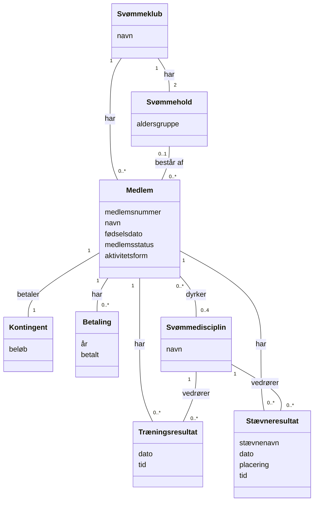

# Domænemodel – Delfinen

Domænemodellen viser de centrale begreber i svømmeklubben
Delfinen og relationerne mellem dem.

## Diagram

## Forretningsregler

- Hvert medlem har et unikt medlemsnummer, som aldrig genbruges.
- Et medlem er enten aktivt eller passivt.
- Aktive medlemmer er enten motionister eller konkurrencesvømmere.
- Juniorer er under 18 år, og seniorer er 18 år eller derover.
- Konkurrencesvømmere tilhører enten juniorholdet eller seniorholdet.
- Konkurrencesvømmere dyrker mindst én svømmedisciplin.
- Der registreres højst én betalingsstatus pr. medlem pr. år.
- Der gemmes kun den bedste træningstid pr. medlem pr. disciplin.
- Alle stævneresultater gemmes.
- Resultater registreres kun i konkurrencesvømmerens aktive discipliner.

## Kontingentsatser

| Medlemskab | Årligt kontingent |
| --- | ---: |
| Passiv | 500 kr. |
| Aktiv under 18 år | 1.000 kr. |
| Aktiv 18-59 år | 1.600 kr. |
| Aktiv 60+ år | 1.200 kr. |

## Multipliciteter

| Multiplicitet | Betydning |
| --- | --- |
| 1 | Præcis én |
| 2 | Præcis to |
| 0..1 | Ingen eller én |
| 0..* | Ingen eller flere |
| 0..4 | Ingen eller op til fire |